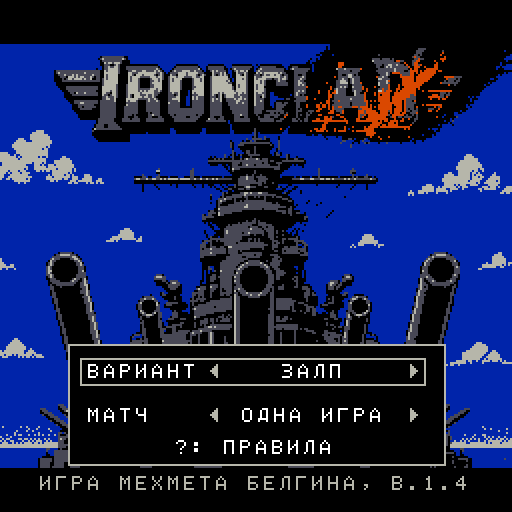
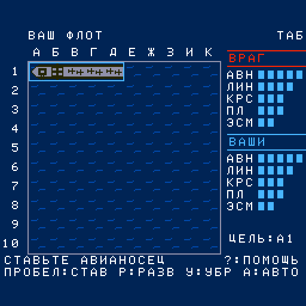
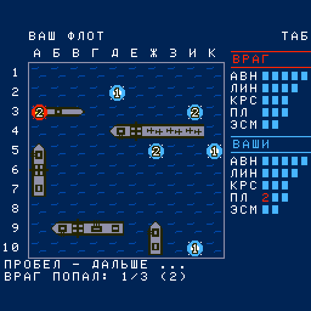
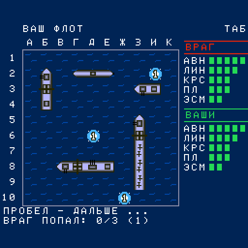
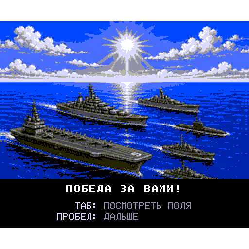
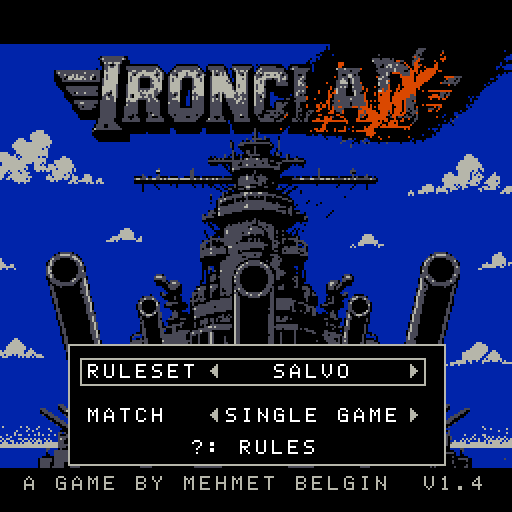
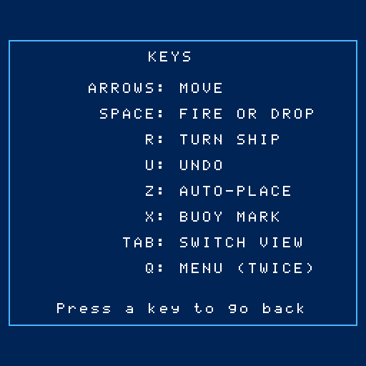

# IRONCLAD → Вектор-06Ц

Порт морского боя [mbelgin/ironclad](https://github.com/mbelgin/ironclad) (Mehmet Belgin, MSX2,
MSX-BASIC + Z80) на ванильный Вектор-06Ц: **i8080, 64 КБ, звук на ВИ53, без квазидиска и без AY**.
Семь наборов правил (залп, классика, «скрытно», «Анка» для детей и другие), ИИ залпов — движок
оригинала, переведённый с Z80 на i8080. Два издания: картридж (8 цветов, один файл .rom) и
дискета (16 цветов, картинки побед и поражений грузятся с диска). Два языка: русский и
английский (язык оригинала).

⚠️ У исходного репозитория нет лицензии. Порт некоммерческий; код и графика оригинала принадлежат
автору, Mehmet Belgin. По его просьбе образы будут убраны.

| Меню | Расстановка | Бой (картридж, 8 цветов) |
|---|---|---|
|  |  |  |

| Бой (дискета, 16 цветов) | Победа (дискета) | Английская версия: меню | Английская: клавиши |
|---|---|---|---|
|  |  |  |  |

## Готовые образы

| Файл | Что это |
|---|---|
| [`rom/ironclad.rom`](rom/ironclad.rom) | картридж, русский, с загрузочной заставкой; 65280 Б (вторая половина файла — картинка прямо в видеопамять, видна во время загрузки). Для MiSTer (ядро Vector-06C) и эмуляторов |
| [`rom/ironclad-nosplash.rom`](rom/ironclad-nosplash.rom) | то же без заставки, 32033 Б: для загрузчиков, которым 64 КБ не по силам, например Вектор Турбо+ из CP/M (`ИМЯ.COM -V T3`) |
| [`rom/ironclad.fdd`](rom/ironclad.fdd) | дискета, русская: 16 цветов, картинки победы и поражения с диска |
| [`rom/ironclad-en.rom`](rom/ironclad-en.rom), [`rom/ironclad-en-nosplash.rom`](rom/ironclad-en-nosplash.rom), [`rom/ironclad-en.fdd`](rom/ironclad-en.fdd) | то же на английском |

Все шесть собирает `tools/build_roms.sh`. Заставка пока — титульная картинка MSX без QR-кода
(своя не нарисована, задание — [docs/SPLASH_BRIEF.md](docs/SPLASH_BRIEF.md)).

## Управление

| Клавиша (рус. / англ.) | Действие |
|---|---|
| стрелки | курсор |
| пробел | огонь / поставить корабль |
| Р / R | развернуть корабль |
| У / U | убрать последний |
| А / Z | авторасстановка |
| Б / X | буй (метка) |
| ТАБ | другое поле (свой флот / воды врага) |
| М / Q | меню (дважды) |
| ? | помощь, в меню — таблица правил |

Джойстик — **«П»** (ВВ55 №2, порт 06h, оба устройства): стрелки — курсор, огонь 1 — пробел,
огонь 2 — ТАБ. Покой джойстика замеряется при старте, нажатием считается отклонение от него.
Порт 0Eh (джойстик «С») не читается: на Вектор Турбо+ там мусор. Читов в игре нет.

## Что переносится

| MSX | Вектор |
|---|---|
| `SETUP.BAS` — меню, 7 наборов правил | `src/setup.asm` |
| `IRONCLAD.BAS` (4 программы: IRONCLAD/SALVO/SALVOP/BARRAGE) | `src/game*.asm` — одна программа, все семейства правил |
| `FOLD*.BIN` — Z80-движок ИИ залпов (3 варианта) | `src/engine/` — i8080, один исходник, вариант выбирается флагами на ходу |
| SCREEN 5 256×212, 16 цветов из 512, 4 видеостраницы | 256×256, 16 цветов из 256; экран MSX сдвинут на 22 строки вниз |
| `SOUND`/`PLAY` (PSG) | ВИ53 |
| `TILES.SC5`, `IRONCLAD.SC5`, `VICTORY.SC5`, `DEFEAT.SC5` | `data/` (собирается `tools/mkdata.py`) |

Логика BASIC переводится **построчно**: метка `L<номер>` = строка исходника
`ref/ironclad-msx/src/IRONCLAD.BAS`, чтобы любое место сверялось с оригиналом.

## Видеостраницы MSX на одном экране Вектора

MSX держит четыре страницы: 0 — «ENEMY WATERS», 1 — «YOUR FLEET», 2 — копия страницы 1 и
экраны помощи/победы, 3 — лист тайлов. На Векторе один экран, поэтому:

* всё, что BASIC рисует на **обе** страницы (`FOR AP=0 TO 1`: панель флотов, строки сообщений,
  рамка, подписи сетки), рисуется один раз прямо в экран;
* то, что у страниц **своё**, хранится как состояние: для каждой из 100 клеток каждой страницы —
  список наложенных тайлов (до 4 слоёв), призрак корабля при расстановке (стр. 1), курсор-спрайт
  (стр. 0), поле `AT:`; смена страницы (TAB) перерисовывает из этого состояния только своё;
* страница 2 = экран поверх: после выхода из помощи/победы страница перерисовывается целиком
  (статика + панель теми же подпрограммами BASIC + строки сообщений + клетки);
* лист тайлов (стр. 3) — готовые плоскостные тайлы 16×16 и глифы 8×10 в ОЗУ.

## Сборка

Нужны:
- macOS на arm64 — ассемблер [sjasmplus](https://github.com/z00m128/sjasmplus) 1.24.0 и упаковщик
  [salvador](https://github.com/emmanuel-marty/salvador) 1.4.2 лежат в `tools/` готовыми; на другой
  системе соберите их сами и положите туда же;
- Python 3 (проверено на 3.14) с Pillow (11.3);
- git и доступ к GitHub: картинки берутся из исходников оригинала, `tools/fetch_ref.sh` сам
  клонирует [mbelgin/ironclad](https://github.com/mbelgin/ironclad) (коммит 8dc2a2c) в
  `ref/ironclad-msx` при первой сборке.

```sh
git clone git@github.com:reqw41/ironclad-v06c.git
cd ironclad-v06c
tools/build_roms.sh       # все шесть образов -> rom/
```

По отдельности:

    ./build.sh                          # картридж, русский: build/ironclad.rom
    DEFS=-DLANG_EN ./build.sh           # английский: build/ironclad_en.rom
    DEFS=-DNOSPLASH ./build.sh          # без заставки (образ до $8000)
    tools/build_disk.sh                 # дискета: build/ironclad.fdd (DEFS=-DLANG_EN — английская)
    tools/build_all.sh                  # картриджи и дискеты обоих языков + таблица размеров

Язык — при сборке. Каждая переводимая строка стоит в исходнике парой `TXT "РУССКАЯ","English"`,
прочие различия (клавиши, координаты подписей) — в `src/lang.asm`, шрифт и словарь строит
`tools/mkdata.py` для каждого языка. Английская версия — как до перевода (строки родителя 30e4f32);
её гейт `tools/gate.sh en` сверяет трассы с той сборкой полностью, со строками и экраном.

Сборка воспроизводима: из чистого клона получаются побайтно те же файлы, что лежат в `rom/`.

## Проверки

Стенды гоняют образ в эмуляторе [vector06js](https://github.com/svofski/vector06js) (Node.js,
проверено на 26). Путь к нему — переменная `V06JS`, по умолчанию `~/projects/vector06js`.

```sh
tools/gate.sh             # логика картриджа: трассы 7 наборов правил против эталонов squeeze_base/
tools/gate.sh en          # то же для английской сборки
tools/gate_disk.sh        # дискета = картридж по всем переменным, автоигра 7 правил до меню (en — английская)
tools/joyp_gate.sh        # джойстик «П»: все направления и обе кнопки; порт 0Eh не читается;
                          # негативный контроль (порт 6 молчит — гейт обязан покраснеть)
tools/lang_shots.sh en ru # снимки основных экранов в build/lang/
```

Эталоны трасс `squeeze_base/` в репозиторий не входят (снимаются `tools/gate.sh base` со сборки до
изменений).

